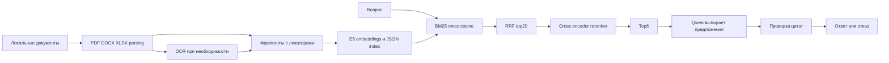

# Отчет о реализации, метриках и развитии enterprise-rag-framework

Дата экспериментального прогона: **11 ноября 2026 года**. Отчет собран по сохраненным результатам и коду baseline; новый прогон моделей для его написания не выполнялся. Код измеренного baseline сохранен коммитом `5de4d3f`.

Репозиторий: [fluffyled/enterprise-rag-framework](https://github.com/fluffyled/enterprise-rag-framework). Работают локальная обработка документов, OCR, hybrid retrieval, reranking и ответы выдержками с проверкой источников. Качество полных инструкций, объединения документов и действующих редакций остается ограничением.

**Итог:** 20 документов, 3 079 фрагментов, ожидаемые документы найдены в 7 из 7 применимых сценариев. Полностью успешны 2 из 8 ответов. Найденный документ и точная цитата не равнозначны правильному и полному ответу. Это небольшой инженерный smoke-набор, а не оценка качества на всей предметной области или баллы хакатона.

## 1. Что реализовано

| Этап | Результат | Файлы |
|---|---|---|
| Исследование | Сравнение RAG, hybrid, reranking, иерархии, цитирования, abstention; 5 open-source проектов; дополнительные QA-наборы. Непроверенные данные отмечены | [research.md](research.md) |
| Аудит | Форматы, страницы, текст/сканы, DOCX-таблицы, XLSX-формулы/объединения, SHA256 | [DATASET_AUDIT.md](DATASET_AUDIT.md) |
| Извлечение | PDFium, python-docx, openpyxl; page/paragraph/table-row/sheet-row locators | [navigator/ingest.py](navigator/ingest.py) |
| OCR | Tesseract rus+eng при тексте страницы короче 80 символов; кэш по SHA256 и странице | [navigator/ingest.py](navigator/ingest.py) |
| Фрагменты | До 110 слов, шаг 90, перекрытие до 20 слов; metadata и parent_id исходного блока | [navigator/ingest.py](navigator/ingest.py) |
| Поиск | Haystack BM25Okapi + normalized dense cosine; RRF top20; cross-encoder reranker; top6 в ответ | [navigator/retrieval.py](navigator/retrieval.py) |
| Ответ | Локальная Qwen выбирает номера предложений в constrained JSON; код извлекает и проверяет цитаты | [navigator/answer.py](navigator/answer.py) |
| UI и CLI | Вопрос, ответ, шаги, возможные конфликты, отказ/ошибка, раскрываемые источники | [app.py](app.py), [navigator/cli.py](navigator/cli.py) |
| Запуск | start/stop, фиксированные зависимости, ревизии и SHA256 моделей, Docker-конфигурация | [README.md](README.md), [models.lock.json](models.lock.json) |
| Проверка | 10 pytest, Streamlit AppTest, 8 реальных сценариев, pip check | [TEST_RESULTS.md](TEST_RESULTS.md) |

Индекс пересобирается целиком при ingest/index. Ошибка файла блокирует замену chunks snapshot. Parent_id сохранен, но полноценный hierarchical/parent-child retrieval не реализован. Даты из имен не доказывают юридическую актуальность.

## 2. Метрики корпуса и обработки

| Показатель | Значение |
|---|---:|
| Документы базы знаний | 20 |
| PDF / DOCX / XLSX | 9 / 8 / 3 |
| Размер исходников | 28 469 871 байт, около 28,47 MB |
| PDF-страницы | 79 |
| Страницы с OCR | 44 из 79, около 55,7% |
| Абзацы / таблицы DOCX | 998 / 44 |
| Листы / формулы XLSX | 4 / 854 |
| Объединенные диапазоны XLSX | 250 |
| Фрагменты | 3 079 |
| Файлы без исключений в финальном ingest | 20 из 20 |
| Точные дубликаты файлов по SHA256 | 0 |
| Индексация E5 CPU | Около 87 секунд в наблюдаемом прогоне |

Отдельно скачано описание кейса DOCX; оно не включено в 20 документов базы знаний. Абзацы/таблицы посчитаны по OOXML, а не по визуальному расположению. Успешный parsing не доказывает безошибочное OCR. CER/WER не измерялись. Формулы не пересчитываются: сохраняются формула и cached value, если оно доступно.

pypdf не прочитал часть PDF из-за `Odd-length string`; использован PDFium. Отозванная pypdfium2 4.30.1 заменена на 4.30.0. Для Tesseract с кириллицей в пути создана ASCII junction к той же папке проекта, без копирования данных.

## 3. Модели, установка и ресурсы

| Компонент | Веса / версия | Зафиксированная ревизия |
|---|---|---|
| Embedding | intfloat/multilingual-e5-small | 614241f622f53c4eeff9890bdc4f31cfecc418b3 |
| Reranker | cross-encoder/mmarco-mMiniLMv2-L12-H384-v1 | 1427fd652930e4ba29e8149678df786c240d8825 |
| LLM | Qwen/Qwen2.5-3B-Instruct-GGUF, qwen2.5-3b-instruct-q4_k_m.gguf | 7dabda4d13d513e3e842b20f0d435c732f172cbe |
| Runtime | llama.cpp CPU b12284, 4 потока, заданный context 8192 | Скрипты запуска и Dockerfile.llm |
| OCR | Tesseract 5.5.3 rus+eng; rus из tessdata_fast 4.1.0 | SHA256 в runtime-checksums.json |

E5 использует query:/passage: и normalized cosine. Лицензии: [THIRD_PARTY.md](THIRD_PARTY.md). Qwen3B имеет **Qwen Research License**; коммерческая пригодность не утверждается. Контрольные суммы: [runtime-checksums.json](runtime-checksums.json).

Git, VS Code и Python уже были установлены. Создана `.venv` на Python 3.11.9. Установлены Haystack 2.13.1, sentence-transformers 3.4.1, transformers 4.49.0, torch 2.6.0+cpu, Streamlit 1.45.0, PDFium 4.30.0, python-docx 1.1.2, openpyxl 3.1.5, pytesseract 0.3.13, Pillow 11.2.1, gdown 5.2.0 и pytest 8.3.5. Для аудита также ставились pypdf и BeautifulSoup. Полный Windows lock: [requirements-lock.txt](requirements-lock.txt), 89 пакетов. Docker и Ollama не устанавливались. Обучения и fine-tuning не было.

| Ресурс | Наблюдение |
|---|---|
| CPU | Intel Core i5-12500H |
| RAM | 16 783 417 344 байт, около 15,6 GiB |
| GPU | RTX 3050 Laptop, 4 096 MiB VRAM; baseline использует CPU |
| Веса E5 / reranker | 470 641 600 / 470 592 698 байт |
| Первоначальная Qwen1.5B | 1 117 320 736 байт; сохранена, не используется |
| Текущая Qwen3B | 2 104 932 768 байт |
| Модели с дополнительными файлами | Около 4,21 GB, включая 1.5B |
| Окружение / инструменты | Около 2,04 GB / 236 MB |
| Весь проект в предыдущем замере | 6 552 321 641 байт, около 6,55 GB; меняется с логами и отчетами |
| llama-server в одном наблюдении | Working set около 3,89 GB; не peak RAM и не полный расход системы |

## 4. Все сохраненные метрики QA

8 разведочных сценариев. Конкретные вопросы, названия внутренних источников, gold ответы и цитаты не публикуются. Полный локальный лог: reports/evaluation.json. Обезличенная сводка: [metrics/baseline_summary.json](metrics/baseline_summary.json).

### 4.1. Сценарии

Документы@6 — все ожидаемые документы присутствуют среди шести фрагментов. Это не Recall@6 релевантных фрагментов.

| Сценарий | Документы@6 | Ручная оценка | Поиск, с | Всего, с | Наблюдение |
|---|---|---|---:|---:|---|
| Простой вопрос | да | partial | 1.145 | 20.939 | Роль верна, есть лишние цитаты; прямой пункт об инициаторе не выбран. |
| Пошаговая инструкция | да | failed | 1.016 | 32.666 | Неполная процедура, посторонняя строка бланка в шагах. |
| Несколько документов | да | partial | 0.445 | 5.989 | Оба документа найдены, ответ цитирует только один. |
| Перефразировка | да | passed | 0.935 | 23.217 | Срок найден, цитата соответствует вопросу. |
| Актуальная редакция | да | partial | 0.966 | 24.729 | Новый документ и отмена прежнего найдены; полная актуальность не проверена. |
| Отсутствующий ответ | н/п | passed | 0.940 | 25.064 | Корректный отказ без выдуманной информации. |
| Возможное противоречие | да | unverified | 0.951 | 6.053 | Отказ; эталонный конфликт не размечен, детектор не оценен. |
| Составной вопрос | да | partial | 0.913 | 11.768 | Специальное правило найдено; порядок действий пропущен, есть смежная норма. |

### 4.2. Сводка качества

| Показатель | Результат | Ограничение |
|---|---|---|
| Полностью успешные | 2 из 8 | 25% этого smoke-набора; не общая accuracy |
| Частичные | 4 из 8 | Есть полезная информация, но ответ неполон или содержит лишнее |
| Неуспешная инструкция | 1 из 8 | Пропущены действия, есть посторонняя строка |
| Конфликтный сценарий | 1 из 8, unverified | Нет gold конфликта; не TP и не TN |
| Все ожидаемые документы@6 | 7 из 7 применимых | Пустой expected_docs не считается успешным retrieval |
| Технический supported_quotes | 6 из 8 | Приняты цитаты, не проверена семантика |
| Технический insufficient | 2 из 8 | Негативный вопрос и возможный конфликт |
| Технический error | 0 из 8 | Только финальный прогон |
| Точные вхождения цитат | 17 из 17 | Повторения ответа/шагов считаются отдельно; не citation precision |
| Реально выведенные шаги | 2 в процедурном сценарии | Инструкция не прошла проверку качества |
| Отказ на заданном неответимом вопросе | 1 из 1 | Не оценка на распределении |
| Проверка gold_terms | 2 из 2 применимых | Совпадение ключевых слов, не полнота/entailment |

Точная цитата может не отвечать на вопрос. Поэтому 17/17 нельзя называть «100% достоверностью». gold_terms прошла и у частичного ответа. Ручные оценки выполнены по ожидаемым результатам; независимой двойной экспертной разметки не было.

### 4.3. Задержки CPU

| Участок | Min, с | Медиана, с | Среднее, с | Max, с |
|---|---:|---:|---:|---:|
| Поиск с reranking | 0.445 | 0.946 | 0.914 | 1.145 |
| После поиска: LLM, HTTP и проверка | 5.102 | 21.038 | 17.889 | 31.649 |
| Полный ответ | 5.989 | 22.078 | 18.803 | 32.666 |

Суммарно восемь последовательных запросов заняли около 150,425 с. Retrieval включает embedding запроса, оба поисковых метода, RRF и reranker. Время после поиска получено разностью общего и retrieval: это не изолированный замер LLM. Инициализация Retriever перед циклом не включена. Warm/cold эффекты, cache и фоновая нагрузка не разделены; повторных прогонов, доверительных интервалов и надежного p95/p99 нет.

### 4.4. Автоматические проверки и отсутствующие показатели

10 pytest прошли с локальным корпусом. Проверяются source ID/цитаты, отказ, запрет внешнего LLM endpoint, порядок DOCX-блоков, XLSX-координаты/формулы, уникальность ID и покрытие файлов. Проверка реального корпуса пропускается при отсутствии приватных данных.

pip check не обнаружил конфликтов. Streamlit AppTest выполнил загрузку и реальный вопрос без exceptions/error; ожидаемый ответ показан, раскрываются 6 источников. Это программный UI-тест, визуального осмотра браузером не было. HTTP health UI и LLM возвращали 200 при проверках запуска. Dockerfile/Compose подготовлены, но чистая Docker-сборка не проверена. Проверенного CI-прогона на GitHub нет.

Qwen1.5B давала ложные отказы и ошибки JSON; один промежуточный вариант ответил на неответимый вопрос. Логи сохранены локально. Затем одновременно изменились модель и prompt/schema. Это **не контролируемая абляция**: нельзя приписывать весь эффект только увеличению модели.

Не измерены: fragment Recall@k, MRR, nDCG, semantic citation precision/recall, поддержка утверждений, полнота шагов, OCR CER/WER, contradiction F1, balanced abstention precision/recall, peak RAM/VRAM, стандартизованные TTFT/tokens/s, concurrency, качество на других корпусах и баллы хакатона. Пропуски не заменяются предположениями.

## 5. Что пока ограничивает качество

Короткие окна могут обрезать пункт или список. Ограничение словами не гарантирует вмещение в tokenizer limit. Заголовки/пункты выделяются эвристикой; автоматическая нумерация Word и OCR-таблицы могут теряться. Страница с длинным, но ошибочным текстовым слоем может не попасть в OCR при нынешнем пороге.

Gold relevance фрагментов не размечена. До шести пересекающихся фрагментов могут повторять похожие места и вытеснять вторую часть составного ответа. Локаторы хранятся, но названия документов, даты и разделы не передаются в LLM отдельной структурной карточкой: prompt содержит предложения с ID. Поэтому смена LLM сама по себе не решает задачу редакций.

Ответ extractive: до 3 предложений и 5 шагов. Это не гарантирует полноту длинной процедуры. Regex-разбиение создает обрывки и строки бланков, которые могут пройти дословную проверку. Определение нехватки информации и конфликтов доверено небольшой LLM. Цепочки отмен, дат вступления в силу и областей применения автоматически не устанавливаются.

## 6. План улучшений по приоритету

Все пункты ниже — **план**, не реализованные возможности. Польза — инженерная гипотеза; величина прироста на нашем корпусе не измерена. Лучший вариант определяется метриками качества, задержками и памятью, а не размером или новизной модели.

| Приоритет | Изменение | Ожидаемая польза | Сложность | Критерии хакатона |
|---|---|---|---|---|
| P0 | Разметить 30–50 вопросов: gold documents/fragments, обязательные шаги, негативы и версии; отделить dev от holdout | Измеримая цель без подгонки под 8 кейсов | Средняя | Поиск 20, ответ 20, цитирование 16 |
| P1 | Разбиение по пунктам, parent-child expansion и tokenizer budget | Полные процедуры и соседние условия | Средняя | Обработка 16, поиск 20, ответ 20 |
| P1 | Удаление перекрывающегося контекста, представление разных документов | Меньше повторов и пропусков частей вопроса | Средняя | Поиск 20, ответ 20 |
| P1 | Фильтрация обрывков/бланков, порядок шагов по документу после выбора | Исправить наблюдаемую ошибку инструкции | Низкая–средняя | Ответ 20, надежность 8 |
| P1 | Проверенный реестр document_family/version/valid_from/valid_to/supersedes/amends | Работа с действующими нормами | Высокая | Поиск 20, неопределенность 16 |
| P2 | Сравнение LLM на неизменном контексте | Проверить полноту выбора и отказы | Средняя; нужны ресурсы | Ответ 20, надежность 8 |
| P2 | Сравнение embedding и reranker на gold retrieval наборе | Обоснованный выбор моделей поиска | Средняя | Поиск 20 |
| P2 | OCR/layout эксперимент на размеченных сканах | Таблицы, пункты, даты и номера | Средняя–высокая | Обработка 16, цитирование 16 |
| P2 | Gold конфликтные пары и независимая проверка противоречий | Измерить ложные срабатывания и пропуски | Высокая | Неопределенность 16 |
| P1 | Чистый Windows/Linux/Docker запуск и замеры cold start | Воспроизводимость для команды | Низкая–средняя | Развертывание 20 |

Сначала стоит исправлять полноту контекста и инструкций: это уже подтвержденная проблема. Большая LLM не может восстановить норму, которая не попала в контекст.

## 7. Кандидаты на замену компонентов

Проверены первичные карточки моделей и документация проектов. Ни один кандидат ниже не тестировался на нашем корпусе. Сведения карточек не являются нашими экспериментальными результатами.

| Текущий компонент | Кандидат и первоисточник | Эксперимент | Ограничение |
|---|---|---|---|
| E5-small | [intfloat/multilingual-e5-base](https://huggingface.co/intfloat/multilingual-e5-base), MIT | Fragment Recall@k и русские перефразы | Более тяжелый encoder; прирост здесь не доказан |
| E5-small dense | [BAAI/bge-m3](https://huggingface.co/BAAI/bge-m3), MIT | Сначала dense; отдельно sparse/multi-vector | По карточке: 1024 измерения, до 8192 tokens; измерять ресурсы и качество |
| mMiniLM reranker | [BAAI/bge-reranker-v2-m3](https://huggingface.co/BAAI/bge-reranker-v2-m3), Apache-2.0 | nDCG@6/MRR и последующий ответ | Multilingual cross-encoder; больше ресурсов не гарантирует лучший ответ |
| Qwen2.5-3B Q4 | [Qwen/Qwen2.5-7B-Instruct-GGUF](https://huggingface.co/Qwen/Qwen2.5-7B-Instruct-GGUF), Apache-2.0; проверить Q4_K_M | Полнота и abstention при том же контексте | Больше RAM. 4 GB VRAM нельзя считать достаточными для полного GPU-размещения с KV cache; CPU/offload проверять отдельно |
| Короткие плоские окна | Parent-child retrieval; [HierarchicalNodeParser + AutoMergingRetriever](https://developers.llamaindex.ai/python/framework/module_guides/loading/node_parsers/modules/#hierarchicalnodeparser) | Полнота процедур при том же token budget | Нужны корректные parents и provenance; переход с Haystack на другой framework необязателен |
| PDFium + Tesseract | [Docling](https://github.com/docling-project/docling), локальная обработка | Порядок блоков, OCR и таблицы | Дополнительные модели, ресурсы и отдельные лицензии весов; качество не гарантируется |
| JSON + in-memory cosine | [Qdrant hybrid queries](https://qdrant.tech/documentation/search/hybrid-queries/) при росте корпуса | Фильтры, обновления, ANN recall и latency | Отдельный сервис; на 3079 фрагментах выгода необязательна |
| Конфликты определяет LLM | [MoritzLaurer/mDeBERTa-v3-base-mnli-xnli](https://huggingface.co/MoritzLaurer/mDeBERTa-v3-base-mnli-xnli) как NLI-кандидат | Entailment/contradiction на размеченных русских парах | Не устанавливает юридическую применимость; требуется проверка в нашем домене |

BGE-M3 поддерживает dense, sparse и multi-vector по карточке автора. **Простая замена имени модели в SentenceTransformer включает только dense-путь нашего кода.** Для остальных режимов требуются отдельная интеграция и индексы. Аналогично добавление Qdrant не создает автоматически новый retrieval algorithm. Лицензии конкретных весов/runtime сверять при внедрении.

## 8. Как менять компоненты в коде

### 8.1. Общий порядок

1. Создать отдельную ветку. Сохранить baseline commit, model SHA, параметры, контрольный набор и исходную метрику.
2. Менять один компонент. Записывать git SHA, tokenizer, prompt/schema, число кандидатов, token budget, hardware и seed, где он поддерживается.
3. Настраивать на dev, оценивать на holdout. Для небольшого набора показывать количества и конкретные ошибки, а не только проценты.
4. Разделять cold start и warm queries, делать повторы, снимать peak RAM/VRAM. Внутренние тексты не отправлять облачному judge.
5. Сравнить пары baseline/candidate по gold fragments и ручной оценке. Принять замену только при улучшении целевой метрики без неприемлемых регрессий.

### 8.2. Embedding

Правки: `scripts/download_models.py`, embedding-секция `models.lock.json`, `build_index()` и `Retriever.search()` в `navigator/retrieval.py`.

Задать repo и **совместимую SHA именно этого repo**. Нельзя оставить SHA прежней модели при смене имени: текущий downloader берет ревизию из lock. Проверить tokenizer, max_length, dimension и query/passage prefix. Для E5 сохранить требуемые префиксы; для другой семьи следовать ее карточке.

Изменить encoding и документов, и запросов. Полностью пересчитать embeddings и индекс. Fingerprint embedding-секции lock уже проверяется кодом. При изменении текста/chunking сначала повторить ingest. Оценивать gold-fragment retrieval и latency, не только наличие нужного документа.

### 8.3. Reranker

Правки: specs/SHA downloader и `Retriever` в `navigator/retrieval.py`. Для модели, совместимой с CrossEncoder, может хватить замены весов. Иначе нужен адаптер к тому же списку кандидатов. Проверить score direction, max_length и batch size. Score не считать вероятностью.

При смене только reranker embeddings переиндексировать не требуется. Сравнивать top20 до reranking и top6 после на одном наборе кандидатов; оценивать также итоговый ответ.

### 8.4. LLM

Правки: repo/SHA/GGUF filename/local_dir в downloader/lock, путь весов в `start.ps1`, `compose.yaml` и README. Сейчас downloader содержит hardcoded filename/directory, поэтому одной правки lock недостаточно.

Остановить прежний сервер через stop.ps1, запустить новый и проверить localhost health. При смене только LLM embeddings не пересчитывать. Для первого сравнения сохранить контекст, `sentence_options`, prompt и JSON schema в `navigator/answer.py` неизменными. Так можно отделить влияние модели от prompt engineering.

Свободная генерация — отдельный эксперимент: ей нужны проверка каждого утверждения и цитирования. Нынешний exact-match валидатор не проверяет новый свободный пересказ. Память и задержки измерять заново.

### 8.5. Chunking, шаги и версии

Правки: `units()`/`ingest()` в `navigator/ingest.py`, расширение контекста в `Retriever`, упаковка метаданных в `navigator/answer.py`.

Сохранять source offsets, пункты, parent sections и строки таблиц, использовать tokenizer budget. Глобальный ключ родителя должен включать документ: `sha256 + parent_id`, поскольку `page-1` встречается в разных файлах. После изменения chunking повторить ingest/index и обновить gold mapping: прежние chunk IDs могут стать недействительными.

При расширении контекста сохранять происхождение каждой цитаты. Шаги группировать по процедуре и исходному порядку, а не только по retrieval score. Названия, даты и разделы передавать модели отдельно. Для редакций использовать проверенные отношения отмены/изменения и область действия; самая поздняя дата не доказывает действующую норму.

### 8.6. OCR и storage

Для OCR-кандидата адаптировать PDF-ветку `units()` с сохранением page/locator/ocr. В ключ OCR-кэша добавить engine/model/config version, чтобы не смешивать новый алгоритм со старыми результатами. Замерить CER/WER на ручных расшифровках, отдельно проверяя даты, номера пунктов и таблицы. При изменении текста повторить ingest/index.

Для Qdrant/другого storage заменить InMemoryDocumentStore и retrievers в `navigator/retrieval.py`, сохранив IDs, meta и модель embedding. Проверить число записей и хеши, ANN сравнить с точным cosine. При неизменном embedding можно переиспользовать векторы, но миграцию нужно проверять. Индексы и payload внутренних документов не публиковать.

## 9. Метрики следующего этапа и определения

| Метрика | Определение и нужная разметка |
|---|---|
| Fragment Recall@k | Найденные gold fragments / все gold fragments вопроса; затем macro по применимым вопросам |
| All-evidence hit@k | Доля вопросов, где найдены все обязательные доказательства; отдельно single/multi-hop |
| MRR@k | Среднее 1/rank первого релевантного фрагмента, 0 при отсутствии; нужны gold relevance labels |
| nDCG@k | DCG / идеальный DCG; нужны graded relevance и единая реализация |
| Semantic citation precision | Доля связей утверждение–цитата, где цитата действительно поддерживает утверждение |
| Citation recall/completeness | Доля проверяемых утверждений с корректным подтверждением |
| Procedure completeness | Правильно покрытые обязательные шаги / все gold шаги; отдельно порядок и лишние действия |
| Abstention precision/recall | Precision: истинно неответимые среди отказов; recall: отказы среди всех неответимых; учитывать ложные отказы и balanced набор |
| Contradiction precision/recall/F1 | Предсказанные пары против gold пар с одинаковыми условиями/областью действия |
| OCR CER/WER | Edit distance по символам/словам / размер эталона; число OCR-страниц не заменяет точность |
| Системные показатели | Cold start, index time, TTFT, стадии retrieval/LLM, median/p95 при достаточных повторах, peak RAM/VRAM, concurrency |
| Воспроизводимость | Чистый запуск с фиксированными версиями, контрольным корпусом и проверенными ожидаемыми результатами |

`scripts/evaluate.py` уже сохраняет timing, источники и простые проверки. Для новых метрик необходимы gold fragments, gold claims/steps, размеченные негативы и конфликты. Без этой разметки заполнение таблицы числами было бы недостоверным.

## 10. Публичная версия проекта

По запросу владельца репозиторий открывается для публичного чтения. Код, тесты, инструкции и агрегированные результаты публикуются. Исходные документы, OCR, индекс, подробные QA-логи, реальные gold вопросы/ответы, веса, исполняемые инструменты, `.venv` и `.env` исключены из Git.

Проверены все версии файлов истории на исключенные пути и типовые шаблоны секретов; находок не было. Это ограниченная автоматическая проверка, не полноценный security audit. Права доступа Google Drive остаются у владельца исходного набора. Публичность GitHub не означает разрешение переиздавать исходные регламенты или веса. Запись сокоманднику предоставляется отдельно через collaborators; изменения удобно делать через ветки и Pull Request.

В этом запросе добавлены отчет и обезличенные метрики, меняется видимость GitHub. Улучшения из разделов 6–9 **не внедрены**, новые модели-кандидаты не скачивались и не обучались. Следующий технический этап — разметка и контролируемые сравнения.
