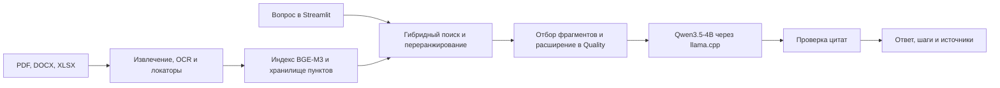

# Чикуф · Навигатор сотрудника по регламентам МФТИ

Сотрудник задаёт вопрос обычным языком. Навигатор находит нужные положения и выдаёт краткий ответ или последовательность действий с цитатами. В интерфейсе можно раскрыть источник, увидеть локатор и скачать оригинал доступной редакции.

**Команда «Чикуф»** — Семёнов Валерий, Шалин Максим, Лабцова Екатерина. Хакатон МФТИ, задача 4.

[Запуск](#запуск) · [Демонстрация](#два-сценария-для-демонстрации) · [Оценка и критерии](#проверка-по-критериям-кейса) · [Результаты](EVALUATION_REPORT.md)

## Что мы разработали

- **Отбор по частям вопроса.** BGE-M3 ищет по смыслу и ключевым словам, BGE-reranker-v2-m3 уточняет порядок, а адаптивный отбор учитывает разные части составного запроса.
- **Восстановление полного пункта.** Quality расширяет найденный фрагмент до родительского пункта, чтобы передать модели связанные условия и исключения. На complex50 полнота поиска пунктов с учётом документа выросла с 70,7% до 89,6%.
- **Структурированная генерация G2.** Qwen3.5-4B Q4_K_M выделяет требования вопроса, извлекает действия и условия по группам источников и собирает ответ. Программа сверяет цитаты с исходным текстом. При нехватке данных интерфейс показывает частичный ответ или отказ, при возможном конфликте показывает спорные положения. Qwen3.5-4B используется и для Legacy, и для G2.
- **Обновляемый корпус.** PDF, DOCX и XLSX загружаются через интерфейс. Для сканов используется Tesseract с русским и английским. Новый снимок заменяет текущий после успешной сборки. Поиск и ответы выполняются локально.

## Запуск

Клонируйте ветку `main`, затем выполняйте команды из корня репозитория. Весам и образам потребуется несколько гигабайт. Для Docker CPU ориентир по памяти — от 16 ГБ. На Windows размещайте проект, Python-окружение и скачанные файлы на D:.

### Windows с NVIDIA CUDA

Нужны Python 3.13, драйвер NVIDIA, [llama.cpp b12284 CUDA 12.4](https://github.com/ggml-org/llama.cpp/releases/tag/b12284) и PowerShell. Из релиза llama.cpp распакуйте сборку и архив CUDA DLL в `tools/llama-cuda`. Для обработки новых сканов установите Tesseract с языками `rus` и `eng`.

```powershell
py -3.13 -m venv .venv
$env:PIP_CACHE_DIR = Join-Path $PWD '.cache/pip'
$env:TEMP = Join-Path $PWD '.cache/tmp'
$env:TMP = $env:TEMP
New-Item -ItemType Directory -Path $env:TEMP -Force | Out-Null
$python = '.\.venv\Scripts\python.exe'
& $python -m pip install -r requirements-cuda.txt
& $python scripts/download_models.py --bge
& $python scripts/download_answer_model.py
.\start.ps1 -Python $python -GpuLayers 6
```

Откройте [Навигатор](http://127.0.0.1:8501). Сборка подхватывает опубликованный индекс. Параметр `-GpuLayers` управляет разгрузкой Qwen на GPU. Значение 6 подходит как исходная настройка для машины с 4 ГБ VRAM. Остановка: `.\stop.ps1`. Логи Windows лежат в `reports/*log`.

### Docker Compose на Linux x86-64

Нужны Docker Engine и Compose v2. Этот профиль запускает поиск и генерацию на CPU. Для Docker Desktop на Windows размещайте хранилище Docker на D: до загрузки образов.

```bash
docker compose config -q
docker compose --profile setup run --rm --build prepare
docker compose up --build -d
docker compose logs -f app llm
```

Дождитесь загрузки модели, затем откройте [интерфейс](http://127.0.0.1:8501). Docker-сервисы связаны закрытой сетью, наружу публикуется только порт интерфейса на localhost. Для остановки выполните `docker compose down`. Статус проверок Docker и Windows приведён ниже.

## Архитектура и поток данных



`navigator/` содержит индексирование, поиск, привязку источников и сервис ответа. `answering/` содержит генерацию G2 и клиент llama.cpp. `ui/` отвечает за загрузку, историю, экспорт и отображение. [Подробнее об архитектуре](architecture.md) · [Инструкция и диагностика](RUNBOOK.md).

## Настройки и внешние сервисы

| Параметр | Назначение |
| --- | --- |
| `NAVIGATOR_INDEX` | Путь к совместимому индексу. Launcher и Compose настроены на опубликованный BGE-индекс. |
| `NAVIGATOR_APPLICATION_CONFIG` | YAML с профилем запуска, по умолчанию [`configs/application.yaml`](configs/application.yaml). |
| `NAVIGATOR_RETRIEVAL_DEVICE` | Опциональное устройство загрузки моделей поиска. Compose использует `cpu`. |
| `LLM_ENDPOINT`, `ANSWER_LLM_ENDPOINT` | Адреса локального llama.cpp для Legacy и G2. В Compose используется `http://llm:8080/v1/chat/completions`. |
| `TESSERACT_CMD`, `TESSDATA_PREFIX` | Путь к OCR и к языковым данным при нестандартной установке. |
| `UI_DATA_DIR`, `UI_TITLE` | Каталог пользовательских данных и название интерфейса. |

Fast + Legacy запускаются по умолчанию. Quality + G2 выбираются в «Настройки → Ответы». G2 делает несколько вызовов модели, поэтому время зависит от объёма найденного контекста. Версии зависимостей и весов зафиксированы в [requirements-cuda.txt](requirements-cuda.txt), [models.lock.json](models.lock.json) и [answer-model.lock.json](answer-model.lock.json).

При подготовке используются GitHub, PyPI, репозиторий колёс PyTorch и Hugging Face. Docker также получает базовые образы и пакеты Debian. Google Drive нужен лишь при отдельном скачивании исходного корпуса. Документы и вопросы при работе приложения передаются локальному серверу модели.

## Два сценария для демонстрации

1. **Ответ со ссылкой.** Загрузите DOCX с текстом «1. Сотрудник подаёт заявку на пропуск за три рабочих дня до визита», нажмите «Построить или обновить базу» и спросите «За сколько рабочих дней нужно подать заявку на пропуск?». Ожидается «за три рабочих дня» и источник с цитатой и локатором.
2. **Недостаточно сведений.** После первого сценария удалите контрольный DOCX, обновите базу и повторите вопрос о пропуске. Для изолированной проверки ветви отказа используйте пустой тестовый корпус. Ожидается статус недостаточности данных без выдуманного срока.

## Проверка по критериям кейса

| Критерий | Где проверить |
| --- | --- |
| Обработка и индексирование | [Извлечение и OCR](navigator/ingest.py), [снимки корпуса](navigator/corpus.py), вкладка «Документы». |
| Поиск | [Fast, Quality и метрики поиска](docs/research/RETRIEVAL_FREEZE_REPORT.md). Актуальность редакций сверяется вручную. |
| Ответ и порядок действий | [Legacy и G2](navigator/generation_service.py), [сквозные проверки](EVALUATION_REPORT.md). Полнота сложных инструкций требует дальнейшей оценки. |
| Цитаты и неопределённость | [Проверка источника](navigator/evidence_adapter.py), частичный ответ, отказ и сигнал о возможном конфликте в интерфейсе. |
| Интерфейс и надёжность | [UI-тесты](tests/test_ui.py), [интеграционные тесты](tests/test_unified_rag.py) и два сценария выше. |
| Развёртывание | [Dockerfile](Dockerfile), [Dockerfile.llm](Dockerfile.llm), [Compose](compose.yaml), инструкция запуска и остановки выше. |
| Применимость и развитие | Локальное демо, загрузка своих документов, история и экспорт. Следующие шаги: проверка редакций, разметка полноты сложных ответов и замеры задержки G2. |

В [отчёте](EVALUATION_REPORT.md) описан сквозной прогон **Fast + Legacy на 150 вопросах**. Quality + G2 проверялись отдельно. Дословность цитаты и лексическое совпадение измеряют разные свойства. [Известные ограничения](KNOWN_LIMITATIONS.md).

```bash
python -m pytest -q
```

Docker Compose подготовлен для чистого запуска. Сборка и запуск контейнеров требуют проверки на машине с Docker Engine.

Технические детали и промежуточные замеры собраны в [исследовательских материалах](docs/research/).
