# Архитектура

```mermaid
flowchart LR
  A[Google Drive dataset] --> B[Local raw files and SHA256]
  B --> C[PDFium / python-docx / openpyxl]
  C --> D[Tesseract rus+eng for scanned pages]
  C --> E[Source blocks with page / paragraph / row]
  D --> E
  E --> F[110-word chunks with overlap]
  F --> G[Local E5 embeddings and JSON snapshot]
  Q[Question] --> H[Haystack BM25 + cosine]
  G --> H
  H --> I[RRF top20]
  I --> J[Local multilingual MiniLM reranker]
  J --> K[Top6 source chunks]
  K --> L[Local Qwen GGUF via llama.cpp]
  L --> M[Exact quote and source validation]
  M --> N[Streamlit / CLI]
```

Это адаптация известного Haystack hybrid pipeline. Сохраняем parent_id исходной страницы, абзаца или строки; полноценное автоматическое parent-child merging не реализовано. В baseline используется flat retrieval по структурным блокам. PDF OCR выполняется только на страницах с текстом короче 80 символов. OCR cache идентифицируется хешем исходника и страницей. При ошибке файла индекс не заменяется. Повторный ingest/index полностью пересобирает snapshot, удаленные файлы исчезают после перестройки.

Модели: intfloat/multilingual-e5-small (CPU, query/passsage prefixes, normalized cosine), cross-encoder/mmarco-mMiniLMv2-L12-H384-v1 (CPU), Qwen/Qwen2.5-3B-Instruct-GGUF Q4_K_M (local llama.cpp, context 8192). SHA в models.lock.json. Бинарник llama.cpp и веса локально, не в Git.

Ответ — extractive grounded QA: модель выбирает номера предложений, код извлекает их дословный текст и проверяет их принадлежность фрагментам и номера источников. Свободный пересказ сознательно не используется в baseline. Это исключает новые факты в сформулированных моделью предложениях, но не гарантирует релевантность выбранной цитаты и правильность порядка шагов. insufficiency определяет небольшая LLM; оценка уверенности по cosine не применяется без калибровки. Полнота сложных ответов не гарантирована. Конфликты — предложения модели с двумя проверяемыми цитатами, семантическая корректность требует проверки. Актуальность юридически не выводится из даты файла.

Документы не отправляются внешним LLM. Сетевые обращения подготовки: Google Drive (скачивание), PyPI/PyTorch (зависимости), Hugging Face (веса), GitHub (инструменты/исходники). Во время QA только localhost, а в Compose имя llm. Телеметрия библиотек отключена. Перед публикацией исключаются data, reports, tools, models, секреты и окружение.
