# Архитектура Enterprise RAG

```text
Streamlit → rag_service → Retriever Fast / Quality
                     → Evidence Adapter → GenerationService Legacy / G2
                     → AnswerResponse → отображение цитат и источников
```

Профили приложения загружаются из `configs/application.yaml`. Fast использует адаптивный поиск BGE-M3, Quality добавляет Parent Expansion. Экземпляр Retriever один на активный снимок индекса, обращения к GPU сериализуются. Evidence Adapter валидирует символьные координаты по извлечённому документу и сохраняет версию и хеш источника. Legacy извлекает цитаты, G2 выделяет атомарные факты и проверяет их дополнительным вызовом. Оба режима повторно проверяют все цитаты перед сборкой ответа.

Рабочее пространство собирает снимки из `data/raw` и файлов staging. Новый снимок включает индекс BGE, исходные тексты, Clause Store и манифест. После успешной сборки приложение переключает активный снимок. При удалении загруженного документа приложение сбрасывает связанные ответы в истории сессии и требует обновления базы.

## Историческая архитектура baseline

# Архитектура

```mermaid
flowchart LR
  A[Google Drive dataset] --> B[Local raw files and SHA256]
  B --> C[PDFium / python-docx / openpyxl]
  C --> D[Tesseract rus+eng for scanned pages]
  C --> E[Source blocks with page / paragraph / row]
  D --> E
  E --> F[110-word chunks with overlap]
  F --> G[Local E5 embeddings and JSON snapshot]
  Q[Question] --> H[Haystack BM25 + cosine]
  G --> H
  H --> I[RRF top20]
  I --> J[Local multilingual MiniLM reranker]
  J --> K[Top6 source chunks]
  K --> L[Local Qwen GGUF via llama.cpp]
  L --> M[Exact quote and source validation]
  M --> N[Streamlit / CLI]
```



Это адаптация известного Haystack hybrid pipeline. Сохраняются parent_id и символьные source spans исходной страницы, абзаца или строки. Baseline использует flat retrieval; parent/sibling expansion реализовано как отдельный отключённый эксперимент H3, но не принято. PDF OCR выполняется только на страницах с текстом короче 80 символов. OCR cache идентифицируется хешем исходника и страницей. При ошибке файла индекс не заменяется. Повторный ingest/index полностью пересобирает snapshot, удаленные файлы исчезают после перестройки.

Модели: intfloat/multilingual-e5-small (query/passsage prefixes, normalized cosine), cross-encoder/mmarco-mMiniLMv2-L12-H384-v1, Qwen/Qwen2.5-3B-Instruct-GGUF Q4_K_M (local llama.cpp, context 8192). Стабильная конфигурация использует CUDA для neural inference; BM25/RRF/selection и parsing/OCR остаются на CPU. `retrieval.device` поддерживает cpu/cuda/auto, а CUDA llama.cpp находится отдельно в tools/llama-cuda. SHA в models.lock.json. Бинарники llama.cpp и веса локально, не в Git.

Ответ — extractive grounded QA: модель выбирает номера предложений, код извлекает их дословный текст и проверяет их принадлежность фрагментам и номера источников. Свободный пересказ сознательно не используется в baseline. Это исключает новые факты в сформулированных моделью предложениях, но не гарантирует релевантность выбранной цитаты и правильность порядка шагов. insufficiency определяет небольшая LLM; оценка уверенности по cosine не применяется без калибровки. Полнота сложных ответов не гарантирована. Конфликты — предложения модели с двумя проверяемыми цитатами, семантическая корректность требует проверки. Актуальность юридически не выводится из даты файла.

Документы не отправляются внешним LLM. Сетевые обращения подготовки: Google Drive (скачивание), PyPI/PyTorch (зависимости), Hugging Face (веса), GitHub (инструменты/исходники). Во время QA только localhost, а в Compose имя llm. Телеметрия библиотек отключена. Перед публикацией исключаются data, reports, tools, models, секреты и окружение.

## Retrieval research

`configs/retrieval_stable.yaml` добавляет к baseline правиловую декомпозицию и coverage-aware greedy selection при неизменных E5/mMiniLM и бюджете контекста. `Retriever.search` сохраняет снимки BM25, dense, RRF, reranker и выбранного контекста, оценки и время этапов без вызова Qwen. Экспериментальные иерархия, contextual indexing, adaptive expansion, graph и BGE-M3 управляются независимыми YAML и по умолчанию выключены. Индекс проверяет модель, chunking, search representation и вычислительное устройство. Метрики, абляции и научные ссылки: [RETRIEVAL_RESEARCH_REPORT.md](RETRIEVAL_RESEARCH_REPORT.md).
