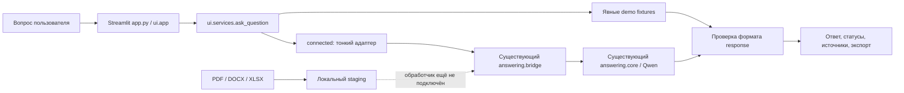

# Архитектура UI

- `app.py` — entry point, настройка кэшей через answering перед Streamlit.
- `ui/app.py` — навигация, формы, session state, история, настройки и документы.
- `ui/views.py` — представление ответа, переходы к источникам, копирование и экспорт.
- `ui/services.py` — демо и существующий backend, обработка ошибок, проверка контракта.
- `ui/storage.py` — локальные JSON, размер и расширение файлов, безопасные имена staging.
- `demo_fixtures/answers.json` — только явно вымышленные примеры.

Контракт запроса: `question`, `document_ids`, `answer_style`, `include_sources`, `source_mode`. Фильтры не поддержаны текущим адаптером, поэтому UI их не активирует.

Ответ: `status` (answered/partial/insufficient/conflict/error), `answer` string, `steps` list[str], `sources` list[object], `conflicts` list[str], `missing_information` list[str], `metadata` (mode, latency_ms). Источник: `id`, `document_id`, `document_title`, `locator`, `excerpt`, необязательные date/url/page/ocr/format. `[n]` — индекс источника в текущем ответе, исходный ID сохраняется. Номера страниц и актуальность не выдумываются.

Адаптер должен возвращать именно источники утверждений, а не произвольные документы. Существование ID не является семантической проверкой. UI не повышает достоверность ответа сам по себе.

Ошибки Retrieval, LLM, формата и локального диска показываются отдельно от insufficient. Пользовательские тексты экранируются перед HTML. Локальные пути backend не открываются произвольно. URL не импортируются. Загрузка не касается индекса.

Состояние сессии: settings, owner, chats, active, files, mode. Сохранение workspace отключено по умолчанию, включается пользователем. Отзывы сохраняются отдельным явным действием. Контент остаётся локальным. Многопользовательский production потребует аутентификации, разделения хранилищ, квот и политики удаления.
