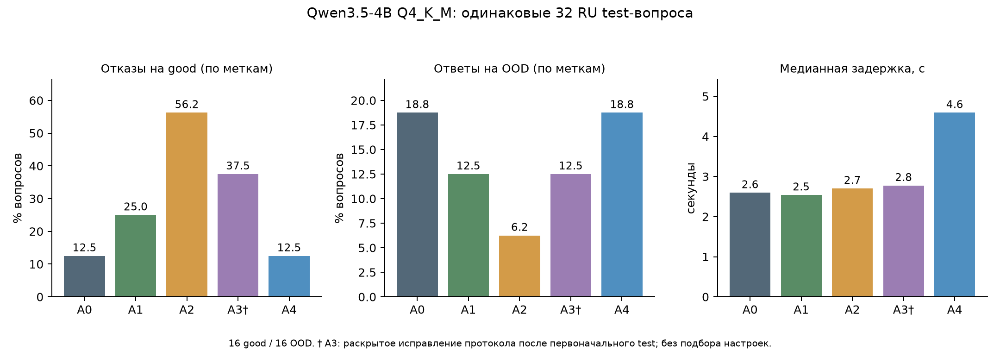

# Эксперимент Qwen3.5-4B для RAG МФТИ

**Результат: универсальное улучшение исходного генератора не доказано.** У целых блоков есть проверенные локальные выигрыши полноты и сохранения условий. Строгий Evidence-first уменьшает OOD-ответы относительно разметки, но повышает отказы на good. Partial восстанавливает часть выдачи и увеличивает набор gold ID, однако найдено перепутывание сущностей и неподтверждённое требование документа. Поэтому A2/A3/A4 не устанавливаются обязательной заменой исходного генератора.

Это реальный локальный эксперимент, а не предложение эксперимента: в runs сохранено **502 отдельных case/configuration результатов**, плюс dev-абляции и диагностические повторы. Основная таблица содержит 200 ответов пяти финальных конфигураций на 40 одинаковых test-примерах; исходный совместный A3-v2 сохранён отдельно ещё на 40 test-примерах. Структурная версия A3 исправлена после исходного test и явно помечена †. Полный журнал позволяет восстановить все сравнения.

## 1. Датасеты

[Grounded-RAG-RU-v2](https://huggingface.co/datasets/Vikhrmodels/Grounded-RAG-RU-v2): официальный train 50 010 / test 200; скачаны первый train shard 25 005 и официальный test 200. Использованы 24 dev и 32 test (поровну good/OOD). Это короткоконтекстный срез до 2600 input tokens, а не полный benchmark. В test 15 связанных документных групп, 9 многодокументных gold-вопросов; 13 отвечаемых примеров содержат отвлекающие документы. Reference и relevant_doc_ids разобраны из разных реплик assistant и не передавались генератору.

[MultiDoc2Dial](https://doc2dial.github.io/multidoc2dial/): 4 train-примера для dev, 8 validation-примеров для отдельного test-среза. Контекст — oracle-секции вокруг gold spans, без запуска Retrieval; языки документов/эталонов английские, новые ответы русские. Все 8 формально answerable, но два примера имеют известные дефекты. Дополнительная clean sensitivity из 6 показана в CSV. Это не официальный полный результат MultiDoc2Dial.

Документные компоненты dev/test не пересекаются по cluster, точному нормализованному тексту и непустым заголовкам. Seed 20261113. Исходные чанки, эталоны и лицензии не гарантируют безошибочность: найден ошибочный good-вопрос про разные фамилии и неверные gold-ID для вопроса на букву «А». Исходные метки не исправлялись скрытно. Поэтому «False Refusal» здесь точно рассчитан **относительно официальной метки**, но не является доказанной истинной частотой необоснованного отказа.

Карточка Grounded-RAG-RU-v2 декларирует Apache-2.0; происхождение текстов Википедии учитывается отдельно. У MD metadata Apache-2.0 расходится с разделом Licensing Information CC BY 3.0. Источники, revisions, SHA256, декларации и расхождения сохранены в [manifest](dataset_manifest.json). Частные 60 вопросов напарника не использованы и не изображены доступными данными.

## 2. Зафиксированная исходная модель

Существующий файл `D:\хакатон\models\answer-llm\Qwen3.5-4B-Q4_K_M.gguf` повторно не скачивался. SHA256: `00fe7986ff5f6b463e62455821146049db6f9313603938a70800d1fb69ef11a4`.

llama.cpp b12284 / 9e9619d03, CUDA 12.4, RTX 3050 Laptop 4 ГБ, RAM около 15.6 GiB. Фактически offloaded 33/33 layers; лог также показывает CPU-mapped model buffer 497.31 MiB и CUDA model buffer 2603.50 MiB. Это GPU-инференс, а не обещание отсутствия любого CPU-оператора. Context 4096, flash attention on, KV K/V q8_0, batch 128 / ubatch 64, threads 4 / parallel 1. Temperature 0, seed 20261113, enable_thinking=false, cache_prompt=false. A0/A1 max output 300; evidence 300; ответ A2/A4 600; extraction A3 700 и его итоговый ответ 600. Chat template и system prompts сохранены в frozen и configuration_manifest.json.

A0 воспроизводит исходный выбор предложений и программную проверку цитат из snapshot напарника. Проблемы: обрыв на сокращениях («род.»), выбор сопутствующего текста, пропущенные соседние требования. Один dev-ответ нарушил контракт конфликтов: один и тот же документ по обе стороны. JSON-валидность и валидация смыслового контракта разделены. Оригинальный HTTP-пакет этого dev-сбоя не сохранился; отдельный replay отмечен как повтор, а не подмена оригинала.

## 3. Изменения

- A1: только смена предложений на целые доступные абзацы/пункты; тот же исходный prompt, schema и decoding. Нет выдуманных пунктов. Выбор ID затем возвращает буквальные блоки, поэтому длинный текст выдаётся без свободного пересказа.
- A2 v2: выбор evidence, затем краткое формирование ответа с цитатами. Проверяются существование ID и схема; семантическая поддержка отдельно. v0 и v2 не смешаны: v0 давал массовые ложные отказы, после dev исправлен слишком широкий запрет действий/сроков.
- A3† procedure v3: evidence selection → отдельное извлечение action/actor/condition/deadline/evidence_ids → отдельный итоговый ответ. Это реальная предварительная экстракция по протоколу, однако модель выдала is_procedure=false во всех 28 dev и 40 test случаях; ветка actions не активировалась. Процедурные вопросы про COE и риск потери жилья отсеялись ещё на evidence selection. Поэтому полезность структурированного извлечения не доказана, а дополнительный вызов сам по себе ничего не исправил. Ранний A3-v2 формировал claims/actions совместно; он сохранён как отдельный прототип и не выдан за строгую последовательность.
- A4 v2: Evidence-first с partial на обеих стадиях; только полезная доказанная часть должна сообщаться как неполная. Найдены ошибки калибровки: полный однозначный ответ иногда помечается partial; сопутствующий факт иногда выдаётся вместо нужного ответа.

A0/A1/A2/A4 и ранний joint-A3 были зафиксированы pretest_lock.json до первого test-вызова. A3-v3 — раскрытое исправление протокола по сравнению кода с исходным заданием, после появления первоначальных ответов; его основной test **не считается новым независимым слепым подтверждением**. Prompt не подбирался по его test-баллам. Для отдельной свежей проверки отложены 5 ещё не использованных official-test групп (1 good / 4 OOD), не пересекающихся документами с dev/main test. Четыре OOD здесь имеют пустой контекст и завершаются программным guard без вызова модели; содержательно это только один дополнительный good-вопрос. Этот срез не подтверждает качество отказов LLM и слишком мал для значимости. Результаты: A0_baseline: answered=1, partial=0, insufficient=4, error=0; A3_procedure_v3: answered=1, partial=0, insufficient=4, error=0.

## 4. Основные результаты: RU, 32 вопроса

| Метрика | A0 | A1 | A2 | A3† | A4 |
|---|---:|---:|---:|---:|---:|
| Отказ на good — относительно метки | 12.5% | 25.0% | 56.2% | 37.5% | 12.5% |
| Ответ на OOD — относительно метки | 18.8% | 12.5% | 6.2% | 12.5% | 18.8% |
| Abstention Precision | 86.7% | 77.8% | 62.5% | 70.0% | 86.7% |
| Abstention Recall | 81.2% | 87.5% | 93.8% | 87.5% | 81.2% |
| Abstention F1 | 83.9% | 82.4% | 75.0% | 77.8% | 83.9% |
| Gold document ID Precision (не semantic citation) | 85.0% | 83.3% | 90.0% | 88.9% | 81.5% |
| Gold document ID Recall (не полнота фактов) | 58.6% | 51.7% | 31.0% | 55.2% | 75.9% |
| JSON Validity по схеме наблюдаемых ответов | 100.0% | 100.0% | 100.0% | 100.0% | 100.0% |
| Валидность итогового программного контракта | 100.0% | 100.0% | 100.0% | 100.0% | 100.0% |
| Error Rate | 0.0% | 0.0% | 0.0% | 0.0% | 0.0% |
| Доля partial | 0.0% | 0.0% | 0.0% | 0.0% | 40.6% |
| Median Latency, seconds | 2.59 | 2.54 | 2.70 | 2.77 | 4.59 |
| p95 Latency, seconds | 3.12 | 3.87 | 5.61 | 6.99 | 8.74 |
| Медиана только answered/partial, seconds | 2.59 | 2.58 | 5.03 | 6.23 | 5.21 |
| Peak VRAM, MiB — всё устройство, sampled | 3462.00 | 3933.00 | 3586.00 | 3462.00 | 3542.00 |
| Peak server working set, MiB — sampled | 8516.38 | 8393.38 | 8483.40 | 8490.81 | 8496.22 |
| Среднее число model calls | 1.00 | 1.00 | 1.41 | 1.81 | 1.88 |
| Средние prompt tokens | 2159.38 | 2005.66 | 2647.91 | 2900.53 | 2986.53 |
| Средние output tokens | 40.00 | 38.09 | 70.22 | 85.44 | 125.47 |
| Средние символы итогового текста | 128.25 | 213.97 | 52.50 | 78.50 | 116.62 |

Для A0 ответы на OOD: 3/16; good-отказы: 2/16. Для A2: 1/16 и 9/16 соответственно. У A4: 3/16 и 2/16. Рост gold-ID recall у A4 не является ростом Faithfulness: в примере с хуторами обе ссылки присутствуют, а числа привязаны к неправильным названиям.

2000 парных bootstrap повторов по 15 документным компонентам, seed 20261113; разница arm − A0. Датасеты не смешаны. Интервалы описывают этот срез, не МФТИ в целом; † остаётся ограничением A3.

| Сравнение | Метрика | Разница | 95% CI |
|---|---|---:|---:|
| A1 minus A0 | Gold document ID Recall [exact] | -6.9 п.п. | [-31.8; +10.0] |
| A1 minus A0 | False Refusal Rate [exact] | +12.5 п.п. | [+0.0; +35.3] |
| A1 minus A0 | False Answer Rate OOD [exact] | -6.2 п.п. | [-18.8; +0.0] |
| A2 minus A0 | Gold document ID Recall [exact] | -27.6 п.п. | [-50.0; -6.1] |
| A2 minus A0 | False Refusal Rate [exact] | +43.8 п.п. | [+16.7; +73.7] |
| A2 minus A0 | False Answer Rate OOD [exact] | -12.5 п.п. | [-26.7; +0.0] |
| A3 minus A0 | Gold document ID Recall [exact] | -3.4 п.п. | [-43.5; +27.0] |
| A3 minus A0 | False Refusal Rate [exact] | +25.0 п.п. | [+5.6; +53.0] |
| A3 minus A0 | False Answer Rate OOD [exact] | -6.2 п.п. | [-25.0; +16.7] |
| A4 minus A0 | Gold document ID Recall [exact] | +17.2 п.п. | [-10.0; +36.6] |
| A4 minus A0 | False Refusal Rate [exact] | +0.0 п.п. | [-23.5; +26.7] |
| A4 minus A0 | False Answer Rate OOD [exact] | +0.0 п.п. | [-16.7; +18.8] |

Интервалы для всех предусмотренных сравнений, включая диагностические self-judge оценки, находятся в paired_bootstrap.csv. Если CI включает ноль, уверенный выигрыш не заявляется. Для семантических чисел отсутствие нуля всё равно не устраняет ошибку самого судьи.

## 5. Процедуры и проверка смысла

Независимой человеческой разметки Faithfulness/Correctness нет. Повторные вызовы той же Qwen сохранены, но выборочная проверка показала смешение неполноты с неподтверждённостью и ложный critical flag. Поэтому self-judge **не принят как валидированный арбитр**. Его результаты — диагностическое приложение в metrics_comparison.csv, с явными названиями и общим оцениваемым набором. Общих независимых значений семантических метрик нет: N/A. У судьи есть пропуски из-за context limit и ошибки; common comparable cases = 29 из 40, список и покрытия — semantic_coverage.json.

Ниже дополнительный **ручной разбор агентом по исходным текстам**, без независимой человеческой проверки, выбранный после ответов для анализа ошибок. Это наблюдения на явно указанных малых срезах, не переносимые средние benchmark-качества. Faithfulness/UCR/Correctness/semantic citations/UAR — только 2 MD-кейса: отзыв заявления и COE. CPR — 6 проверенных условий в 4 MD-кейсах; Procedure Completeness — 7 единиц ответа в 4 MD-кейсах. Полные атомы, решения и объяснения — source_review.json. Нулевые знаменатели отдельно дают N/A. Промежуточные traces не считаются итоговым текстом.

| Метрика | A0 | A1 | A2 | A3† | A4 |
|---|---:|---:|---:|---:|---:|
| Answer Correctness — 2 MD audit | 75.0% | 100.0% | 50.0% | 50.0% | 50.0% |
| Faithfulness — 2 MD audit | 100.0% | 100.0% | 100.0% | 100.0% | 75.0% |
| Unsupported Claim Rate — 2 MD audit | 0.0% | 0.0% | 0.0% | 0.0% | 25.0% |
| Citation Precision — 2 MD audit | 100.0% | 100.0% | 100.0% | 100.0% | 75.0% |
| Citation Recall — 2 MD audit | 100.0% | 100.0% | 100.0% | 100.0% | 75.0% |
| Condition Preservation Rate — 4 MD, 6 units | 66.7% | 100.0% | 33.3% | 33.3% | 50.0% |
| Procedure Completeness — 4 MD, 7 units | 85.7% | 100.0% | 42.9% | 42.9% | 57.1% |
| Unsupported Action Rate — 2 MD audit | 0.0% | 0.0% | 0.0% | 0.0% | 33.3% |

Все исходные 8 MD test-примеров по точным метрикам:

| Метрика | A0 | A1 | A2 | A3† | A4 |
|---|---:|---:|---:|---:|---:|
| Отказ на good — относительно метки | 25.0% | 12.5% | 62.5% | 62.5% | 37.5% |
| Ответ на OOD — относительно метки | N/A | N/A | N/A | N/A | N/A |
| Abstention Precision | 0.0% | 0.0% | 0.0% | 0.0% | 0.0% |
| Abstention Recall | N/A | N/A | N/A | N/A | N/A |
| Abstention F1 | N/A | N/A | N/A | N/A | N/A |
| Gold document ID Precision (не semantic citation) | 100.0% | 100.0% | 100.0% | 100.0% | 100.0% |
| Gold document ID Recall (не полнота фактов) | 75.0% | 87.5% | 37.5% | 37.5% | 62.5% |
| JSON Validity по схеме наблюдаемых ответов | 100.0% | 100.0% | 100.0% | 100.0% | 100.0% |
| Валидность итогового программного контракта | 100.0% | 100.0% | 100.0% | 100.0% | 100.0% |
| Error Rate | 0.0% | 0.0% | 0.0% | 0.0% | 0.0% |
| Доля partial | 0.0% | 0.0% | 0.0% | 0.0% | 62.5% |
| Median Latency, seconds | 0.89 | 1.05 | 0.76 | 0.79 | 3.09 |
| p95 Latency, seconds | 1.43 | 1.27 | 3.39 | 4.43 | 5.57 |
| Медиана только answered/partial, seconds | 0.93 | 1.18 | 3.34 | 4.15 | 3.50 |
| Peak VRAM, MiB — всё устройство, sampled | 3492.00 | 3663.00 | 3585.00 | 3437.00 | 3520.00 |
| Peak server working set, MiB — sampled | 8494.34 | 8243.04 | 8470.75 | 8513.60 | 8496.61 |
| Среднее число model calls | 1.00 | 1.00 | 1.38 | 1.75 | 1.75 |
| Средние prompt tokens | 385.50 | 375.50 | 420.38 | 593.12 | 579.25 |
| Средние output tokens | 29.50 | 32.25 | 56.00 | 64.38 | 109.25 |
| Средние символы итогового текста | 126.88 | 409.88 | 67.12 | 60.50 | 162.38 |

Условие первоначального SSN и ограничение помощи участием в co-op важнее формального наличия ID. «Подать заявку на COE» нельзя заменять требованием уже получить документ для доступа к помощи. Локальный выигрыш A1 — сохранение возврата выплат рядом с 12-месячным сроком и сохранение ограничений co-op. Одновременно A1 раздувает краткие фактические ответы до целой биографии и повышает отказы на RU good относительно метки.

## 6. Анализ ошибок

[error_analysis.md](error_analysis.md) содержит реальные ответы до/после: сохранённый шаг, потерянное условие, перепутанные сущности и источники, неизменившийся правильный факт, ложный partial, ошибочный эталон и неподтверждённое требование. Категории без надёжной разметки или наблюдений так и обозначены; ошибки порядка действий и истинный глобальный UAR не выдуманы.

Обнаружена ошибка нашей подготовки MD oracle-контекста: text_sec был взят без доступного title «Do not». Исправление находится в structured_context.py; отдельный незаслеплённый контекстный case study не подмешан в основной benchmark. Это показывает, почему генератор не должен компенсировать потерянное отрицание своими знаниями. Исходные фиксированные входы и ответы не переписаны.

## 7. Скорость, память и абляции

Число вызовов и полный wall-clock показаны выше. Отказы часто завершаются на первой стадии: поэтому общая медиана A2/A3 может выглядеть близкой к A0, хотя отвечаемые запросы требуют двух/трёх вызовов. Отдельная медиана answered/partial предотвращает такую подмену. GPU-память — sampled device-wide значение, не точный эксклюзивный пик процесса. Main test серийный; фиксированный порядок arm и нагрев GPU ограничивают сравнение без повторов. Некоторые dev-v0/v2 вызовы пересекались в очереди и для speed claim не используются.

[ablation_report.md](ablation_report.md): 18 дополнительных dev-вызовов проверяют начало/середину/конец, полный/короткий oracle-контекст и one-step против evidence-first. Малый срез не доказывает общий эффект. Thinking и перебор температуры не выполнялись; проверенные и непроверенные гипотезы разделены. Денежных API-вызовов генерации нет: все нейросетевые запросы локальные. Электроэнергия и износ не измерялись, нулевая полная стоимость не заявляется.

## 8. Научное обоснование

[research_basis.md](research_basis.md) связывает протокол с [ALCE](https://arxiv.org/abs/2305.14627), [Sufficient Context](https://arxiv.org/abs/2411.06037), [MultiDoc2Dial](https://arxiv.org/abs/2109.12595), [Lost in the Middle](https://arxiv.org/abs/2307.03172) и исследованием [document-grounded evaluation](https://arxiv.org/abs/2309.11838). Они обосновывают проверку атрибуции, достаточности контекста, позиции доказательств и ограничений автоматического оценивания; не доказывают выигрыш данного квантованного checkpoint.

## 9. Применимость к МФТИ и рекомендация

Проверены механизмы на открытых данных, а не качество внутреннего навигатора. В Википедии меньше обязательных согласований, редакций и локальных ролей; MD англоязычный и oracle. Отсутствуют реальная выдача и scores Retrieval напарника, частный holdout и независимая проверка регламентов. End-to-end вывод о МФТИ делать нельзя.

**Сохранить A0 контролем; A1 считать кандидатом для проверки процедурных регламентов, а не универсальной обязательной заменой.** Преимущество целых блоков подтверждено отдельными примерами, но краткость и отказы регрессируют. A2 слишком часто отказывается относительно меток; A3 добавляет вызов и не устраняет доказанные ограничения автоматически; A4 нельзя принимать по снижению отказов/росту ID recall из-за обнаруженных семантических ошибок. Production-код и Retrieval не переключены.

Для интеграционной проверки передавать устойчивые document/block IDs и исходные заголовки/условия, отображать partial явно и проверять не только наличие ID, но и связь каждого утверждения с доказательством. На новых закрытых документах МФТИ нужны независимые метки обязательных шагов/условий и критических ошибок. Веса 40/25/20/15 не считаются официальными и не используются как единственный критерий: высокий средний балл может скрыть один выдуманный обязательный срок или документ.

## 10. Следующий этап и воспроизводимость

[training_feasibility.md](training_feasibility.md): обучение не запускалось. LoRA может сохранять базу замороженной, но имеющегося GGUF недостаточно для стандартного SFT. Документация Unsloth указывает около 10 ГБ для BF16 LoRA 4B и предупреждает о QLoRA для Qwen3.5. На этой 4-ГБ GPU сначала улучшать контекст, метки и генератор. Переход к обучению оправдан лишь для устойчивых, независимо подтверждённых ошибок при достаточном контексте и наличии проверенного train/нового holdout.

Все рабочие файлы находятся в `D:\хакатон\experiments\qwen35_public_2026-11-13`. Ветки main/sevsese, исходные индексы и веса не менялись. Повторные запуски сохранять в новой директории; существующие per-case результаты не перезаписывать. baseline.py и run_v2.py пропускают имеющиеся записи и создают новые через exclusive open. Конфигурации и raw HTTP запросы/ответы сохранены, version hashes — в manifest/lock и итоговом integrity manifest.

Основные файлы: dataset_manifest.json, model_manifest.json, configuration_manifest.json, baseline_results.json, a1_results.json, a2_results.json, a3_results.json, a4_results.json, metrics_comparison.csv, per_case_metrics.csv, paired_bootstrap.csv, source_review.json, source_review_metrics.json, error_analysis.md, ablation_report.md, training_feasibility.md. Исходный joint-A3-v2 не удалён. Успешные HTTP-вызовы содержат usage/latency и точную schema; известная потеря original raw одного A0 dev-сбоя раскрыта выше.
